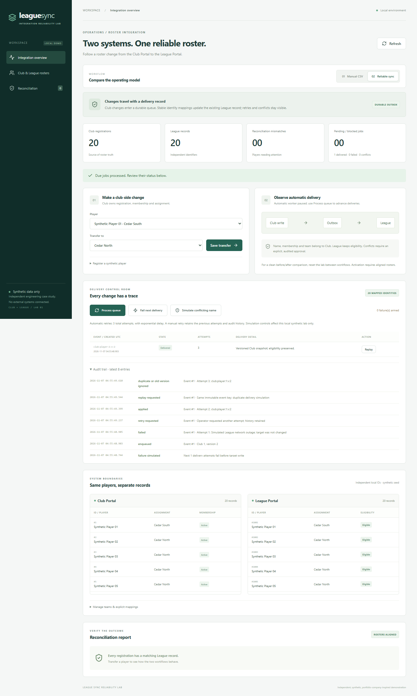
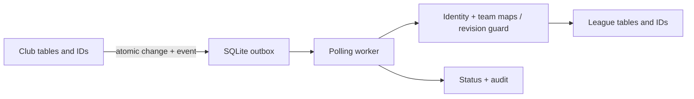

# League Sync Reliability Lab

Club staff export registration CSVs, upload them to a separate League portal, then investigate discrepancies. The original team-scoped importer handles registrations but retains an old assignment after a transfer. This demo adds a durable synchronization path with stable identity mapping, replay protection, bounded retries and explicit conflict review.

**Independent, synthetic, portfolio-company-inspired demonstration.** No Beacon production systems, real customer information, credentials, paid APIs or runtime AI. Codex assisted the engineering work; ordinary deterministic software moves the roster data.



## Verified outcome

The same 20-player seed and 10 transfers produced **10 → 0 mismatched players** and **30 → 20 League records** after delivery and duplicate replay. The defined routine handoff path has **3 → 0 additional operator actions** after a Club transfer. These are workflow action counts, not measured human time savings. Both workflows accepted **2/3 deliveries** in a separate injected-outage probe; acceptance alone did not imply correct reconciliation.

See [results and methodology](docs/03-results.md), [raw measurements](evidence/comparison.json), [command output](evidence/verification.json), and the [portfolio case study](portfolio/case-study.md).

## Setup on Ubuntu / WSL

Prerequisites: Python **3.11+**, Node.js **22.12+**, npm, Git, Bash. Commands run from this repository root. If Python's venv module is missing: `sudo apt-get update && sudo apt-get install -y python3-venv`.

```bash
python3 -m venv .venv
.venv/bin/python -m pip install -r backend/requirements.lock
npm --prefix frontend ci
bash scripts/reset-demo.sh
```

`backend/requirements.txt` lists direct dependencies; `requirements.lock` pins the complete evidence environment. `frontend/package-lock.json` pins npm dependencies. Internet is needed for initial package/browser installation; the product itself uses local assets and local APIs.

Start the backend in terminal 1:

```bash
bash scripts/run-backend.sh
```

Start the frontend in terminal 2:

```bash
bash scripts/run-frontend.sh
```

Open **http://127.0.0.1:5173**. FastAPI runs on **8001**; API documentation is at **http://127.0.0.1:8001/docs**. The default workflow is Manual CSV. The backend worker checks the queue every 0.5 seconds independently of the browser, delivering changes in reliable mode. For a paced demo with manual processing controls, start the backend with `SYNC_AUTORUN=0 bash scripts/run-backend.sh`.

## Tests and reproducible measurements

```bash
.venv/bin/python -m pytest backend/tests -q
npm --prefix frontend run build
npm --prefix frontend run format:check
npm --prefix frontend audit --audit-level=moderate
.venv/bin/python scripts/benchmark.py --mode both

# Install once for UI tests; OS libraries may require sudo.
npm --prefix frontend exec -- playwright install --with-deps chromium
npm --prefix frontend run test:ui

# All checks; actual output goes to evidence/verification.json.
bash scripts/check.sh
```

If Chrome is installed, skip the browser download and use:

```bash
PLAYWRIGHT_CHANNEL=chrome npm --prefix frontend run test:ui
bash scripts/check.sh --browser-channel chrome
```

The verifier records exit codes and returns nonzero on failure. `--skip-ui` explicitly reports a skipped UI test; it is not the full gate. Playwright owns ports **5183 / 8011** and resets **only `data/ui-test.sqlite3`** before each test. Benchmark databases are temporary files under this repository's `data/`; they do not alter the interactive demo. Tests generate PNG screenshots, JUnit XML and Playwright JSON in `evidence/`.

Validation ran on Windows using `.venv/Scripts/python.exe` and `npm.cmd`; Ubuntu/WSL equivalents are documented here. Linux execution has not been measured. **50 backend tests and 3 UI tests passed**, as did typecheck/build and formatting. npm audit reported zero vulnerabilities. One upstream Starlette/AnyIO deprecation warning remains. See the [unexpected-adapter-error fix](docs/06-unexpected-adapter-errors.md) for bounded recovery and strict per-player ordering, and the [workflow/replay fix](docs/07-workflow-replay-recovery.md) for safe switching and recovery from historical trapped replays.

## Reset and demo

Stop both interactive servers, then:

```bash
bash scripts/reset-demo.sh
```

Restart servers. Reset recreates 2 clubs, 4 teams, 20 Club registrations and 20 distinct League records, clears events/audit/mappings/fault settings, and selects baseline mode. It deletes local demo changes. Use it between workflow comparisons; reliable activation refuses misaligned rosters rather than guessing how to migrate duplicates.

Follow [the demo script](docs/demo-script.md) for transfer, CSV replay, automatic sync, temporary failure, retry, conflict review and explicit team mapping.

## Configuration

| Setting | Default | Usage |
| --- | --- | --- |
| `BACKEND_PORT` | `8001` | Backend runner shell variable |
| `FRONTEND_PORT` | `5173` | Vite shell variable or root `.env` |
| `VITE_API_TARGET` | `http://127.0.0.1:8001` | Vite proxy; shell variable or root `.env` |
| `LEAGUE_DB` | `<repo>/data/demo.sqlite3` | Backend shell variable; use a path inside this repo |
| `SYNC_AUTORUN` | `1` | Backend: `0` pauses automatic delivery |
| `FRONTEND_ORIGINS` | localhost / 127.0.0.1 on 5173 | Direct-browser CORS origins, comma-separated; same-origin Vite proxy needs no change |

Alternate ports:

```bash
# Terminal 1
BACKEND_PORT=8021 bash scripts/run-backend.sh
# Terminal 2
FRONTEND_PORT=5193 VITE_API_TARGET=http://127.0.0.1:8021 bash scripts/run-frontend.sh
```

Optional: `cp .env.example .env`. Vite reads this root file; the backend uses exported shell settings. Use the same `LEAGUE_DB` for reset and the server.

## Code and ownership



| Responsibility | Files |
| --- | --- |
| Separate schemas, transactions, seed | [db.py](backend/db.py), [seed.py](backend/seed.py) |
| Original CSV contract and live reconciliation | [service.py](backend/service.py) |
| Outbox, mapping, retry, replay, conflict handling | [sync.py](backend/sync.py) |
| Validated HTTP contracts and worker lifecycle | [app.py](backend/app.py) |
| Original behavior and reliability regressions | [backend tests](backend/tests) |
| Workflow, rosters, team management and delivery UI | [main.tsx](frontend/src/main.tsx), [operations.tsx](frontend/src/operations.tsx) |
| Browser smoke test | [smoke.spec.ts](frontend/tests/smoke.spec.ts) |
| Experiment and verification | [benchmark.py](scripts/benchmark.py), [verify.py](scripts/verify.py) |

Club owns player name, membership and assignment. League owns eligibility. A League name edit increments the revision and blocks the next Club update; resolution requires a reason and the reviewed revision. Eligibility survives sync. Mapping changes are integration operations, never inferred by an LLM.

## Phase evidence and handoff

1. [Baseline](docs/01-baseline.md): `3b9cc2e`, `baseline: working original workflow`, tag **`baseline-demo`**.
2. [Diagnosis](docs/02-diagnosis.md): `bffab16`, reproducible shortcoming before improvement.
3. [Improvement](docs/gate-03-improvement.md): `382ccf6`, `improvement: add durable roster synchronization`.
4. [Evaluation](docs/03-results.md): measurements, sample sizes and unchanged outcomes.
5. [AI engineering process](docs/04-ai-engineering-process.md), [tradeoffs](docs/05-tradeoffs.md), [demo](docs/demo-script.md), [case study](portfolio/case-study.md).

Inspect the original without changing the checkout: `git show baseline-demo:backend/service.py` and `git show baseline-demo:docs/01-baseline.md`. `git log --oneline --decorate` shows phase order.

## Troubleshooting and boundaries

- **Port occupied:** use alternate ports above. Vite uses strict ports; do not stop unrelated processes.
- **Proxy error:** check `curl http://127.0.0.1:8001/api/health` and `VITE_API_TARGET`; restart Vite after changing config.
- **Activation returns 409:** pending/failed/conflicting jobs prevent workflow changes. Process/retry/resolve them in Reliable sync. For a historical pending replay trapped in Manual CSV, review it and use `POST /api/sync/events/{id}/cancel-replay` with a reason; the API requires proof of prior delivery. See [recovery instructions](docs/07-workflow-replay-recovery.md). Misaligned rosters still require the existing clean comparison/reset procedure; recovery does not bypass alignment.
- **Job failed:** inspect error/audit. The first two failures schedule retries after 2 and 4 seconds; after 3 attempts it stays failed. Correct the cause and use Retry. Clear simulated outages with `curl -X POST http://127.0.0.1:8001/api/sync/failure -H 'Content-Type: application/json' -d '{"attempts":0}'`.
- **Conflict:** compare source snapshot and League record. Supply the missing team mapping or approve Club authority with a reason. Stale target revisions reject approval.
- **Browser dependencies / ENOSPC:** use installed Chrome or install Playwright Chromium when space is available. The initial download failed here; the UI suite subsequently passed in Chrome.
- **SQLite locked:** stop extra demo servers/workers and retry; writes serialize with a 15-second busy timeout. Stop servers before reset. Do not share this SQLite file across networked hosts.

This is a local, unauthenticated lab: bind to loopback. Real adapters, distributed exactly-once delivery, cross-club transfers, authentication, tenant isolation, payments and notifications are out of scope. UI lists show the latest 100 jobs / 200 audit entries; full local history remains in SQLite. See [tradeoffs](docs/05-tradeoffs.md) before adapting it.
